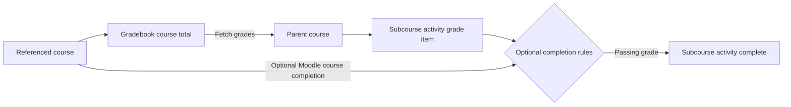

# Subcourse activity for Moodle

[](https://github.com/Portvgal/moodle-mod_subcourse/actions/workflows/moodle-ci.yml?query=branch%3AMOODLE_405_STABLE)

The Subcourse activity lets one Moodle course include the final grade, progress, and completion result of another course as a graded activity.

When a Subcourse activity is added to a parent course, it points to a referenced course. Each student's final grade from that course is fetched into the parent course gradebook as the Subcourse activity grade. Combined with [Course meta link enrolments](https://docs.moodle.org/en/Course_meta_link), this supports programmes made from separate unit courses while preserving centralised grade and completion reporting.

## Contents

- [Key features](#key-features)
- [How it works](#how-it-works)
- [Compatibility](#compatibility)
- [Installation](#installation)
- [Basic usage](#basic-usage)
- [Activity settings](#activity-settings)
- [Completion settings](#completion-settings)
- [Grade synchronisation](#grade-synchronisation)
- [Administration, capabilities, and mobile support](#administration-capabilities-and-mobile-support)
- [Privacy, support, and licence](#privacy-support-and-licence)

## Key features

- Imports a student's final grade from a referenced course into the parent course gradebook.
- Supports real-value and percentage-preserving grade transfer.
- Fetches grades manually, in response to grade events, or through a scheduled task.
- Provides a strict Subcourse passing-grade completion rule so a failing grade remains incomplete.
- Optionally requires Moodle's whole-course completion status from the referenced course.
- Optionally returns the activity to incomplete if referenced-course completion is later removed.
- Shows referenced-course grade and progress on the parent course page.
- Can redirect the activity directly to the referenced course, optionally in a new window.
- Includes Moodle App support for the referenced-course link, progress, and fetched grade.

## How it works



Subcourse connects two separate Moodle concepts:

| Concept | Meaning | How Subcourse uses it |
|---|---|---|
| **Gradebook Course Total** | The numeric final grade calculated by the referenced course gradebook. | Fetched into the Subcourse activity grade item. |
| **Moodle Course completion** | The referenced course's whole-course completion status, calculated from that course's configured completion criteria. | Used only when **Also require Moodle course completion** is enabled. |

A final grade does not automatically mean that Moodle considers the referenced course complete. For most grade-based workflows, configure the referenced course total's grade to pass and use the Subcourse passing-grade rule. Enable Moodle Course completion only when the referenced course has its own course-completion criteria and that separate status is required.

## Compatibility

| Moodle version | Branch |
|---|---|
| Moodle 4.5–5.0 | [`MOODLE_405_STABLE`](https://github.com/Portvgal/moodle-mod_subcourse/tree/MOODLE_405_STABLE) |
| Moodle 5.1 | [`MOODLE_501_STABLE`](https://github.com/Portvgal/moodle-mod_subcourse/tree/MOODLE_501_STABLE) |

This branch declares Moodle 4.5 as its minimum and Moodle 5.0 as its maximum supported version in `version.php`.

## Installation

Follow Moodle's [standard plugin installation instructions](https://docs.moodle.org/en/Installing_plugins#Installing_a_plugin).

The plugin directory must be named `subcourse` and installed at:

```text
/path/to/moodle/mod/subcourse
```

After copying or extracting the plugin, visit **Site administration → Notifications** or run Moodle's command-line upgrade:

```bash
php admin/cli/upgrade.php
```

## Basic usage

1. Create a parent course and one or more courses that will act as referenced subcourses.
2. Enrol students in both the parent and referenced courses.
3. Configure the referenced course gradebook, including its course-total grade to pass when required.
4. In the parent course, add one Subcourse activity for each referenced course.
5. Choose the referenced course under **Fetch grades from**.
6. Select the grade-transfer, display, link, and completion options required by the workflow.
7. Let students complete work and receive grades in the referenced course.
8. Fetch grades manually or allow the event and scheduled-task processes to synchronise them.
9. Confirm that the referenced course total appears as the Subcourse activity grade in the parent course.

## Activity settings

### Referenced course

**Fetch grades from** selects the course that the activity reads from. A course cannot reference itself.

The selector contains courses whose gradebooks the editing user can view. If a previously selected course is no longer available to that user, the form allows the existing reference to be retained.

### Fetch grades as

| Mode | Behaviour |
|---|---|
| **Real values** | Copies the referenced course's actual final-grade value. Use this when the parent course should store the same numeric result. |
| **Percentual values** | Recalculates the grade so the percentage shown in the Subcourse activity matches the referenced course percentage. Use this when grade ranges differ or excluded grades make the raw value and displayed percentage differ. |

The Subcourse grade item synchronises relevant settings from the referenced course total, including grade type, minimum and maximum grade, scale, visibility, and grade to pass. A referenced course total that uses a non-global local scale cannot be fetched because that scale is unavailable outside its course.

### Link behaviour

- **Redirect to the referenced course** sends users directly to that course when they open the activity. Users who can fetch grades manually continue to see the Subcourse page and fetch action.
- **Open in a new window** applies when redirecting and opens the referenced course in a separate browser window.

### Course-page display

- **Display progress from referenced course on course page** shows the student's referenced-course progress beside the activity.
- **Display grade from referenced course on course page** shows the student's fetched grade beside the activity.

These options control the parent course page. The Subcourse activity page and Moodle App can still display referenced-course information.

## Completion settings

Subcourse supports Moodle's standard activity-completion settings and adds rules for referenced-course results.

### Recommended grade-based completion

For the common requirement “complete this activity when the student passes the referenced course”:

1. Set the referenced course total's grade to pass.
2. Add or edit the Subcourse activity in the parent course.
3. Enable automatic activity completion.
4. Enable the passing-grade completion option.
5. Leave **Also require Moodle course completion** disabled unless the referenced course's separate whole-course completion status is also required.

Subcourse stores this as a strict plugin completion rule. A fetched failing grade remains incomplete; completion requires the fetched grade to be greater than or equal to the activity's grade to pass. When possible, the Subcourse grade to pass defaults from the referenced course total.

### Also require Moodle course completion

Enable **Also require Moodle course completion** only when the referenced course has Moodle Course completion enabled and configured. With this rule active, the Subcourse activity completes only when Moodle reports that the student has completed the referenced course.

Moodle updates this through referenced-course completion events. The scheduled task `\mod_subcourse\task\check_completed_refcourses` also checks affected activities so missed or older completion records can be synchronised.

### Undo completion when the referenced course changes

By default, an activity that Moodle has marked complete remains complete. Enable **Undo this if Moodle course completion is removed** when the parent activity must return to incomplete after Moodle removes the student's completed status in the referenced course.

### Choosing completion rules

| Requirement | Configuration |
|---|---|
| Complete when the student earns a passing referenced-course grade | Enable the Subcourse passing-grade rule. |
| Complete when Moodle marks the whole referenced course complete | Enable **Also require Moodle course completion**. |
| Require both conditions | Enable both rules; the student must satisfy both. |
| Reverse completion when whole-course completion is removed | Enable the Moodle course-completion rule and its reversible option. |

## Grade synchronisation

Grades can be fetched in three ways:

- **Manually:** a user with `mod/subcourse:fetchgrades` selects **Fetch grades now**.
- **Event-driven:** Moodle responds to relevant grade events in the referenced course.
- **Scheduled:** the task `\mod_subcourse\task\fetch_grades` refreshes Subcourse grades.

Completion is recalculated after relevant grade fetches. Referenced-course completion events and the completion-check task keep the optional whole-course completion rule synchronised.

## Administration, capabilities, and mobile support

### Site administration defaults

The plugin provides defaults under the Subcourse activity administration settings:

- **Progress on course page** controls the default for referenced-course progress display.
- **Grade on course page** controls the default for referenced-course grade display.
- **Display hidden courses** controls whether hidden courses appear in the referenced-course selector.

### Capabilities

| Capability | Purpose |
|---|---|
| `mod/subcourse:addinstance` | Add a Subcourse activity. |
| `mod/subcourse:view` | View the activity. |
| `mod/subcourse:fetchgrades` | Fetch grades manually from the referenced course. |
| `mod/subcourse:begraded` | Receive a grade from the referenced course. |

### Moodle App

The plugin includes Moodle App support for viewing Subcourse information, including the referenced-course link, current progress, and fetched grade.

## Privacy, support, and licence

### Privacy

The plugin declares a Moodle Privacy API null provider because it does not directly store personal data in its own tables. Fetched grades are written through Moodle's gradebook APIs and are handled by Moodle's core gradebook privacy processes.

### Support and issue reporting

- Report problems with this fork through the [Portvgal issue tracker](https://github.com/Portvgal/moodle-mod_subcourse/issues).
- The upstream project is [Catalyst IT's Subcourse repository](https://github.com/catalyst/moodle-mod_subcourse).
- Community support is available through the [Moodle activities forum](https://moodle.org/mod/forum/view.php?id=44).
- Commercial support is available from [Catalyst IT](https://www.catalyst.net.nz/contact-us).

### Authors and maintenance

The module was originally written by David Mudrák and is maintained upstream by Catalyst IT. This fork contains additional branch-specific development and compatibility work by [Portvgal](https://github.com/Portvgal).

### Licence

This plugin is free software distributed under the [GNU General Public License v3.0 or later](LICENSE).
